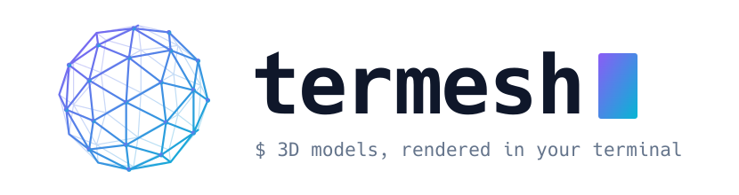
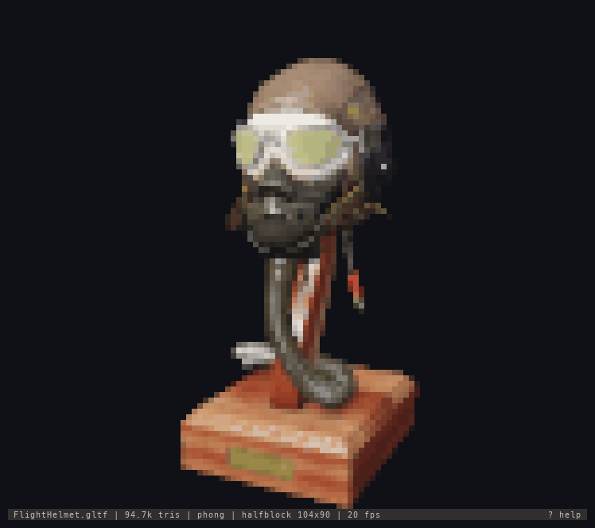
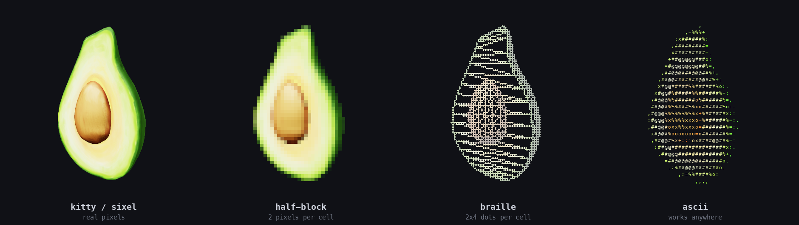
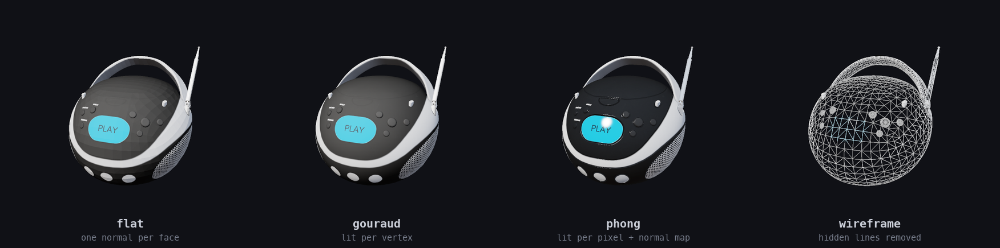

<div align="center">

<picture>
  <source media="(prefers-color-scheme: dark)" srcset="docs/media/banner-dark.svg">
  <source media="(prefers-color-scheme: light)" srcset="docs/media/banner-light.svg">
  
</picture>

**A 3D model viewer that lives in your terminal.**<br>
Textured, lit, depth-buffered 3D from a software rasterizer written from scratch in C++20. No OpenGL, no GPU.

[](https://github.com/aubergine-ux/termesh/actions/workflows/ci.yml)
[](https://github.com/aubergine-ux/termesh/releases/latest)
[](LICENSE)


[Install](#-install) · [Usage](#-usage) · [Backends](#-output-backends) · [How it works](#-how-it-works) · [Architecture](ARCHITECTURE.md)

<br>

<p>

</p>

<p>
<sub>
<code>termesh FlightHelmet.gltf</code> · 94,722 triangles, drawn with half-block characters.<br>
This is the program's real terminal output, captured and replayed frame by frame.
</sub>
</p>

</div>

<br>

```sh
termesh model.glb
```

That is the whole interface. termesh loads the model, works out what your terminal can display, and gives you
a smooth, shaded, spinning view you can orbit with the mouse.

## ✨ Features

|     |     |
| :-: | --- |
| 🔺 | **A complete pipeline, from scratch**: vertex transform, homogeneous clipping, back-face culling, depth-buffered tile rasterization, perspective-correct texturing. |
| 💡 | **Real shading**: flat, Gouraud, Phong, physically based (metallic / roughness, as glTF defines it) and toon with ink outlines; diffuse and normal maps, mip-mapping, alpha blending, hidden-line wireframe. |
| 🌅 | **Lighting**: soft shadow maps, HDR environment maps with image-based lighting and a skybox, plus SSAO, bloom, FXAA and a choice of tone curves. |
| 🖥️ | **Five ways to draw**: Kitty graphics, Sixel, 24-bit half-blocks, Braille dots and plain ASCII. The best one is picked automatically. |
| ⚡ | **Fast**: multithreaded tiles, SIMD (SSE2 / NEON), BVH frustum culling, automatic level of detail, and only the cells that changed are redrawn. A 95k-triangle model renders in about 2 ms, and detail and resolution adapt to hold a target frame rate. |
| 🦊 | **Animation**: glTF skeletal animation with skinning, morph targets and cross-fades between clips, plus a timeline you can pause, scrub, slow down or run backwards. |
| 🖱️ | **Interactive**: orbit, pan and zoom with the mouse or keyboard, click a mesh to inspect it, switch shading live, toggle auto-rotate and a stats bar. |
| 🎬 | **Scenes**: several models with their own transforms, lights and a camera, described in a small [JSON scene file](docs/scenes.md); camera paths for turntables and flythroughs; a scene inspector sidebar. |
| 📦 | **Formats**: OBJ (+ MTL), glTF 2.0 (`.gltf` / `.glb`), STL and PLY, all read by loaders written here; point clouds drawn as splats; FBX, COLLADA and dozens more through an optional Assimp backend. |
| 🎞️ | **Exports**: save the view as a PNG, record a turntable GIF, or print one frame into your scrollback. |
| 🧩 | **Fits in**: a `--preview` mode for [yazi, lf and ranger](docs/previews.md), and the whole renderer as a library, [libtermesh](docs/library.md), with a stable C API. |
| 🪶 | **Small and portable**: Linux, macOS and Windows Terminal. Three vendored single-header dependencies, one static binary. |
| 📖 | **Meant to be read**: a few thousand lines of commented C++, with a guided tour in [ARCHITECTURE.md](ARCHITECTURE.md). |

## 📥 Install

Grab a pre-built binary from the [latest release](https://github.com/aubergine-ux/termesh/releases/latest).
There is nothing to install: unpack and run.

<details open>
<summary><b>Linux</b> (x86_64)</summary>

```sh
curl -LO https://github.com/aubergine-ux/termesh/releases/latest/download/termesh-linux-x86_64.tar.gz
tar -xzf termesh-linux-x86_64.tar.gz
./termesh-linux-x86_64/termesh --demo knot
```

</details>

<details>
<summary><b>macOS</b> (Apple Silicon and Intel)</summary>

```sh
curl -LO https://github.com/aubergine-ux/termesh/releases/latest/download/termesh-macos-universal.tar.gz
tar -xzf termesh-macos-universal.tar.gz
./termesh-macos-universal/termesh --demo knot
```

</details>

<details>
<summary><b>Windows</b> (x86_64, PowerShell in Windows Terminal)</summary>

```powershell
Invoke-WebRequest https://github.com/aubergine-ux/termesh/releases/latest/download/termesh-windows-x86_64.zip -OutFile termesh.zip
Expand-Archive termesh.zip -DestinationPath .
.\termesh-windows-x86_64\termesh.exe --demo knot
```

</details>

<details>
<summary><b>From source</b> (CMake 3.20+ and a C++20 compiler)</summary>

```sh
git clone https://github.com/aubergine-ux/termesh.git
cd termesh
cmake -B build -DCMAKE_BUILD_TYPE=Release
cmake --build build --parallel
./build/termesh --demo knot
```

Recent GCC, Clang, Apple Clang and MSVC 2022 all work. With a multi-config generator such as Visual Studio,
build with `cmake --build build --config Release` and run `build\Release\termesh.exe`.

</details>

No model to hand? `--demo knot`, `--demo cube`, `--demo sphere` and the animated `--demo tentacle` are built
in, and [`scripts/fetch-samples.sh`](scripts/fetch-samples.sh) downloads a few glTF sample models to play with.

## 🚀 Usage

```sh
termesh model.glb                       # view a model
termesh model.obj --shading flat        # pick a shading mode
termesh model.gltf --backend braille    # force an output backend
termesh model.glb --png view.png        # render a still image
termesh model.glb --spin --gif out.gif  # record a 360° turntable
termesh model.glb --print               # print one frame and exit
termesh fox.glb --animation Run         # play a named animation
termesh fox.glb --list-animations       # see which animations a file has
termesh model.glb -s pbr --env sky --shadows   # physically based, lit by a sky, with shadows
termesh model.glb -s toon               # cel shading with ink outlines
termesh a.glb b.glb c.obj               # several models side by side
termesh examples/showroom.json          # a scene: models, lights, camera path
```

### Controls

| Action                 | Mouse                     | Keys                          |
| ---------------------- | ------------------------- | ----------------------------- |
| Orbit                  | drag                      | arrows, <kbd>h</kbd> <kbd>j</kbd> <kbd>k</kbd> <kbd>l</kbd> |
| Select a mesh          | click                     |                               |
| Scene inspector        | click a row               | <kbd>Tab</kbd>; arrows move, <kbd>←</kbd> <kbd>→</kbd> fold |
| Follow the camera path / take over |               | <kbd>v</kbd>                  |
| Pan                    | right-drag, or shift-drag | shift + arrows, <kbd>H</kbd> <kbd>J</kbd> <kbd>K</kbd> <kbd>L</kbd> |
| Zoom                   | wheel                     | <kbd>+</kbd> <kbd>-</kbd>     |
| Auto-rotate on / off   |                           | <kbd>space</kbd>              |
| Reset the view         |                           | <kbd>r</kbd>                  |
| Flat / Gouraud / Phong / PBR / toon |              | <kbd>1</kbd> – <kbd>5</kbd>, or <kbd>s</kbd> to cycle |
| Wireframe              |                           | <kbd>w</kbd>                  |
| Textures, normal maps  |                           | <kbd>t</kbd>, <kbd>n</kbd>    |
| Back-face culling      |                           | <kbd>c</kbd>                  |
| Turn the light         |                           | <kbd>[</kbd> <kbd>]</kbd>     |
| Shadows                |                           | <kbd>x</kbd>                  |
| Next environment, sky background |                 | <kbd>e</kbd>, <kbd>y</kbd>    |
| Ambient occlusion, bloom, outlines, FXAA |         | <kbd>u</kbd> <kbd>g</kbd> <kbd>i</kbd> <kbd>f</kbd> |
| Tone curve, exposure   |                           | <kbd>z</kbd>, <kbd>{</kbd> <kbd>}</kbd> |
| Dithering mode         |                           | <kbd>d</kbd>                  |
| Draw as points; smaller / larger points |          | <kbd>P</kbd>, <kbd>(</kbd> <kbd>)</kbd> |
| Play / pause animation |                           | <kbd>a</kbd>                  |
| Step back / forward    |                           | <kbd>,</kbd> <kbd>.</kbd>     |
| Slower / faster        |                           | <kbd>&lt;</kbd> <kbd>&gt;</kbd> |
| Next / previous animation |                        | <kbd>m</kbd> <kbd>M</kbd>     |
| Next output backend    |                           | <kbd>b</kbd>                  |
| Status bar             |                           | <kbd>o</kbd>                  |
| Save a PNG             |                           | <kbd>p</kbd>                  |
| Help, quit             |                           | <kbd>?</kbd>, <kbd>q</kbd>    |

<details>
<summary><b>All command-line options</b></summary>

<br>

| Option | Meaning |
| ------ | ------- |
| `-b`, `--backend <name>` | `kitty`, `sixel`, `halfblock`, `braille` or `ascii` (default: best available) |
| `--color <depth>` | `truecolor`, `256` or `none` (default: detect) |
| `--dither <mode>` | `auto`, `none`, `ordered` or `fs` (Floyd-Steinberg); with Braille, `ordered` / `fs` draw a shaded halftone |
| `-s`, `--shading <mode>` | `flat`, `gouraud`, `phong` (default), `pbr` or `toon` |
| `--shadows`, `--shadow-size <n>`, `--shadow-softness <1-7>` | shadows from the key light |
| `--light-angle <deg>` | turn the key light about the vertical axis |
| `--env <name\|file>` | environment lighting: `studio`, `sky`, `sunset`, or an `.hdr` panorama |
| `--skybox`, `--no-skybox`, `--sky-blur <0-1>` | draw the environment as the background |
| `--env-intensity <x>`, `--env-rotation <deg>` | brightness and turn of the environment |
| `--ssao`, `--bloom`, `--fxaa` | ambient occlusion, glow, fast anti-aliasing |
| `--outline`, `--no-outline` | ink outlines (on by default with toon shading) |
| `--tonemap <curve>`, `--exposure <stops>` | `aces` (default), `reinhard`, `filmic` or `linear` |
| `-w`, `--wireframe` | start in wireframe mode |
| `--no-textures`, `--no-normal-maps`, `--no-cull` | switch parts of the renderer off |
| `--points`, `--point-size <x>` | draw every mesh as points; scale the splats |
| `--bg <rrggbb>` | background colour |
| `--ssaa <n>` | supersampling factor, 1-4 |
| `--threads <n>` | worker threads (default: all cores) |
| `--fps <n>` | frame rate limit (default: 60) |
| `--target-fps <n>` | lower detail and resolution to hold this rate while moving; 0 never does (default: 30) |
| `--lod <px>` | level of detail: error allowed in pixels, or `off` (default: 0.5 in the viewer, off for exports) |
| `--yaw`, `--pitch`, `--zoom`, `--fov` | initial camera |
| `--camera-time <s>`, `--no-path` | where along a scene's camera path to start; ignore the path |
| `--spin`, `--no-spin`, `--spin-speed <deg/s>` | auto-rotation |
| `--no-stats` | hide the status bar |
| `--animation <a>` | animation to play, by number (from 1) or name |
| `--anim-time <s>`, `--anim-speed <x>`, `--paused` | where to start, playback rate (negative runs backwards), start paused |
| `--list-animations` | print the animations in the file and exit |
| `--print`, `--cols <n>`, `--rows <n>` | print one frame into the scrollback |
| `--png <file>`, `--size <WxH>` | render a still image |
| `--gif <file>`, `--frames <n>`, `--gif-fps <n>` | record a turntable, or one loop of an animation |
| `--blocks <n>` | draw exported images with chunky n×n pixels, like terminal cells |
| `--bench <n>` | render n frames off-screen and print timings |
| `--benchmark`, `--benchmark-scene <name>`, `--benchmark-list`, `--benchmark-json <file>` | run the built-in benchmark suite |
| `--demo <name>` | built-in model: `knot`, `cube`, `sphere`, `tentacle` (animated) |

</details>

### Exporting

```sh
# A 1920×1080 still of the default view
termesh model.glb --png shot.png --size 1920x1080

# A looping 360° turntable, 72 frames at 24 fps
termesh model.glb --spin --gif spin.gif --size 480x360

# The same, with big square pixels like the half-block backend draws
termesh model.glb --spin --gif spin.gif --size 480x480 --blocks 6

# One seamless loop of an animation (add --spin to turn the camera too)
termesh fox.glb --animation Run --gif run.gif --size 480x360

# A still from 0.4 s into an animation
termesh fox.glb --animation Run --anim-time 0.4 --png stride.png

# One frame, straight into the terminal
termesh model.glb --print --cols 60
```

In the viewer, <kbd>p</kbd> saves the current view as `termesh-<model>-NN.png`. PNG encoding uses
stb_image_write; the GIF encoder (median-cut palette, LZW, inter-frame deltas) is part of termesh.

## 📺 Output backends

termesh asks the terminal what it supports at start-up and picks the best option. Press <kbd>b</kbd> to step
through the others.

<div align="center">

</div>

| Backend      | Resolution per cell | Used when                                                            |
| ------------ | ------------------- | -------------------------------------------------------------------- |
| `kitty`      | real pixels         | the terminal answers a kitty graphics query (kitty, Ghostty, WezTerm, Konsole…) |
| `sixel`      | real pixels         | the terminal reports sixel support (foot, xterm, mlterm, Windows Terminal 1.22+…) |
| `halfblock`  | 1 × 2 pixels        | Unicode and colour are available, which covers nearly every modern terminal |
| `braille`    | 2 × 4 dots          | wireframe mode on a half-block terminal switches to this automatically |
| `ascii`      | 1 character         | nothing else works; also handy over a slow link                      |

Cell-based backends keep a copy of what is on screen and send only the cells that changed, wrapped in a
synchronized update so frames never tear.

## 🎨 Shading

<div align="center">

</div>

These three modes use the same Blinn-Phong lighting; what changes is how often it is evaluated. Flat shading
lights each triangle once, Gouraud lights each vertex and interpolates the colour, and Phong interpolates the
normal and lights every pixel, which is also what makes normal maps possible.

Two more models work per pixel. `--shading pbr` is the microfacet model glTF materials are written for
(Cook-Torrance with GGX), which with `--env` picks up image-based lighting from an HDR panorama. `--shading toon`
snaps the lighting to a few flat tones and inks the silhouettes and creases. Shadows, ambient occlusion, bloom
and the tone curve can be switched on over any of them.

## 🔧 How it works

```
 model file ─► loader ─► vertex stage ─► clipping ─► projection + culling
                                                             │
   terminal ◄─ backend ◄─ resolve ◄─ shading ◄─ rasterizer ◄─ tile binning
```

1. **Vertex stage**: every vertex is transformed to clip space once, in parallel.
2. **Clipping**: triangles crossing the view frustum are cut in homogeneous coordinates (Sutherland-Hodgman),
   before the perspective divide can misbehave.
3. **Setup**: divide by *w*, map to the viewport, cull back faces, snap to a 1/16-pixel grid.
4. **Binning**: triangles are sorted into 32×32-pixel tiles, and tiles are handed to worker threads.
5. **Rasterization**: integer edge functions with a top-left fill rule decide coverage, four pixels at a time
   with SIMD; survivors are depth-tested.
6. **Shading**: attributes are interpolated with perspective correction and fed to the fragment shader.
7. **Resolve and present**: supersamples are averaged in linear light and the image is handed to a backend.

**[ARCHITECTURE.md](ARCHITECTURE.md)** walks through each stage in detail, with the maths behind clipping and
perspective-correct interpolation and pointers into the code.

<details>
<summary><b>Source layout</b></summary>

```
src/
├── math/       vectors, matrices, quaternions
├── core/       framebuffer, textures, colour, thread pool
├── scene/      model, camera, OBJ and glTF loaders
├── pipeline/   vertex stage, clipping, lighting, renderer
├── raster/     triangle and line rasterizer, SIMD wrappers
├── output/     kitty, sixel, half-block, Braille, ASCII
├── input/      raw terminal I/O, key and mouse parsing
├── export/     PNG, GIF, off-screen rendering
└── app/        command line, capability detection, viewer
```

</details>

## ⚡ Performance

The [Flight Helmet](https://github.com/KhronosGroup/glTF-Sample-Assets/tree/main/Models/FlightHelmet) model
(94,722 triangles, fifteen textures) on a Ryzen 7 5800X with 8 cores / 16 threads, measured with
`termesh FlightHelmet.gltf --bench 300`:

| Render target                                         | Flat    | Gouraud | Phong   |
| ----------------------------------------------------- | ------- | ------- | ------- |
| 600 × 354 (a 200×60 terminal, half-blocks, 3× SSAA)   | 2.6 ms  | 2.6 ms  | 2.7 ms  |
| 900 × 580 (kitty / sixel at the default pixel budget) | 4.1 ms  | 3.8 ms  | 4.9 ms  |
| 1920 × 1080                                           | 9.4 ms  | 9.5 ms  | 13.4 ms |

Those are renderer times, with no terminal attached. On one thread the first row takes 18 ms, so even a single
core holds 30 fps. In practice the terminal emulator is the limit, which is why the cell backends work hard to
send as little as possible: for a spinning model a half-block frame is a few tens of kilobytes, against a
couple of hundred for a full redraw.

## 🧪 Building and testing

```sh
cmake -B build -DCMAKE_BUILD_TYPE=Release
cmake --build build --parallel
ctest --test-dir build --output-on-failure
```

| CMake option             | Default | Effect                                              |
| ------------------------ | ------- | --------------------------------------------------- |
| `TERMESH_BUILD_TESTS`    | `ON`    | build the doctest unit tests                        |
| `TERMESH_NATIVE`         | `OFF`   | compile with `-march=native`                        |
| `TERMESH_STATIC`         | `OFF`   | link the C++ runtime statically (release binaries)  |
| `TERMESH_BUILD_LIBRARY`  | `ON`    | build libtermesh, the renderer as a C library       |
| `TERMESH_LIBRARY_STATIC` | `OFF`   | make libtermesh a static library instead of shared  |
| `TERMESH_ASSIMP`         | `OFF`   | read FBX, COLLADA and more through Assimp           |

The tests cover the maths library, clipping, the rasterizer's fill rule and perspective correction, texture
sampling, both loaders, every output backend, the GIF encoder and the input parser. CI runs them on Linux
(GCC, Clang, and with SIMD disabled), macOS on Apple Silicon and Windows with MSVC, plus an
AddressSanitizer / UBSan build. Formatting follows the checked-in `.clang-format`.

## 🚧 Limitations

- Skinning uses at most four bones per vertex, and glTF cameras and lights are ignored.
- Secondary UV sets are ignored, and a mesh that is normal-mapped does not also show vertex colours.
- Point clouds without normals are shaded as if every point faced the viewer.
- The Assimp backend imports geometry and materials, not animation.
- Draco- and meshopt-compressed geometry and KTX2 / WebP textures are not supported.
- Translucent surfaces are sorted per triangle, so two that intersect each other can blend in the wrong order.
- Shadows come from directional and spot lights, not point lights, and only in the per-pixel shading modes.
- Environment reflections use the panorama's mip chain rather than a full prefiltering pass.

## 🙏 Credits

- [cgltf](https://github.com/jkuhlmann/cgltf) by Johannes Kuhlmann, for glTF parsing (MIT)
- [stb_image and stb_image_write](https://github.com/nothings/stb) by Sean Barrett, for image decoding and PNG writing (public domain / MIT)
- [doctest](https://github.com/doctest/doctest) by Viktor Kirilov, for unit testing (MIT)
- The models in the images above are *Flight Helmet*, *Boom Box* and *Avocado* from the
  [Khronos glTF Sample Assets](https://github.com/KhronosGroup/glTF-Sample-Assets), all released under CC0.

<br>

<div align="center">

Released under the [MIT License](LICENSE) · Made by [Aubergine-UX](https://github.com/aubergine-ux)

<sub>If termesh made your terminal a little more three-dimensional, a ⭐ is appreciated.</sub>

</div>
