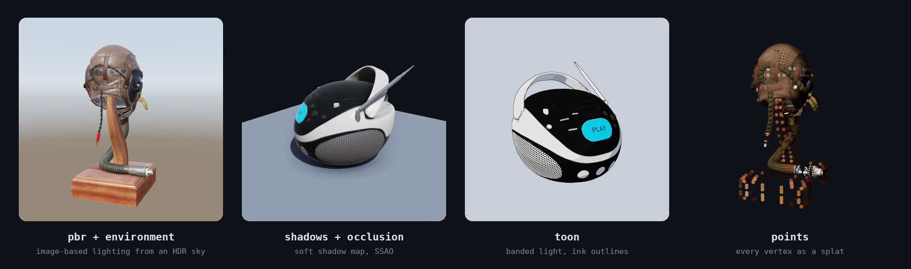
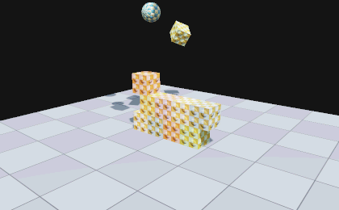
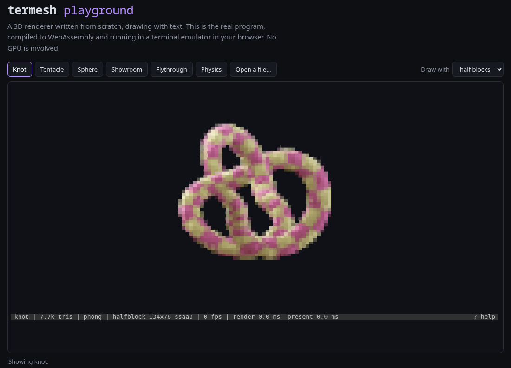
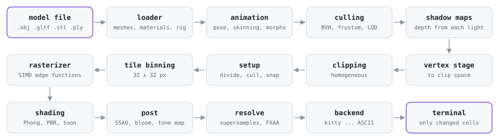

<div align="center">

<picture>
  <source media="(prefers-color-scheme: dark)" srcset="docs/media/banner-dark.svg">
  <source media="(prefers-color-scheme: light)" srcset="docs/media/banner-light.svg">
  
</picture>

### A 3D engine that lives in your terminal

Textured, lit, shadowed, animated 3D from a software rasterizer written from scratch in C++20.<br>
No OpenGL, no GPU, no dependencies to install. Just text.

[](https://github.com/aubergine-ux/termesh/actions/workflows/ci.yml)
[](https://github.com/aubergine-ux/termesh/releases/latest)
[](LICENSE)


[Features](#-features) · [Install](#-install) · [Usage](#-usage) · [Rendering](#-rendering) · [Integrations](#-integrations) · [How it works](#-how-it-works) · [Architecture](ARCHITECTURE.md)

<br>

<p>

</p>

<p>
<sub>
<code>termesh FlightHelmet.gltf</code> · 94,722 triangles, drawn with half-block characters.<br>
This is the program's real terminal output, captured and replayed frame by frame.
</sub>
</p>

</div>

<br>

```sh
termesh model.glb
```

That is the whole interface. termesh loads the model, works out what your terminal can display, and gives you
a smooth, shaded, spinning view you can orbit with the mouse. Everything else on this page is optional.

## ✨ Features

|     |     |
| :-: | --- |
| 🔺 | **A complete pipeline, from scratch**: vertex transform, homogeneous clipping, back-face culling, depth-buffered tile rasterization and perspective-correct texturing, all in readable C++. |
| 💡 | **Real shading**: flat, Gouraud, Phong, physically based (metallic / roughness with emissive and alpha blending) and toon with ink outlines. |
| 🌅 | **Lighting and effects**: soft shadow maps for directional and spot lights, HDR environment maps with image-based lighting and a skybox, SSAO, bloom, FXAA, four tone curves, and dithering tuned to each output mode. |
| 🦊 | **Animation**: glTF skeletal animation with skinning, morph targets and cross-fades between clips, on a timeline you can pause, scrub, slow down or run backwards. |
| 🎬 | **Scenes**: any number of models with their own transforms, lights and camera in a small [JSON scene file](docs/scenes.md); camera paths for turntables and flythroughs; a scene inspector sidebar; click a mesh to select it. |
| 📦 | **Formats**: OBJ, glTF 2.0, STL and PLY, read by loaders written here; point clouds drawn as splats; FBX, COLLADA and dozens more through an optional Assimp backend. |
| ⚡ | **Fast**: multithreaded tiles, SIMD (SSE2 / NEON / WebAssembly), BVH frustum culling, automatic level of detail, and resolution that adapts to hold a target frame rate. A 95k-triangle model renders in about 3 ms. |
| 🖥️ | **Five ways to draw**: Kitty graphics, Sixel, 24-bit half-blocks, Braille dots and plain ASCII. The best one is picked automatically. |
| 🎞️ | **Recording**: PNG stills, looping GIFs, MP4 video, and [asciinema](https://asciinema.org) casts of a live session. |
| 🧩 | **Integrations**: previews in [yazi, lf and ranger](docs/previews.md); the renderer as a [C library](docs/library.md) and a [Python package](docs/python.md); a [WebAssembly build](#-in-the-browser) that runs in the browser; [plugins](docs/plugins.md) for new formats and backends. |
| 🧱 | **A physics demo**: a small rigid-body engine, because a renderer wants something to render. |
| 🪶 | **Small and portable**: Linux, macOS and Windows. Three vendored single-header dependencies; the release is one static binary. |
| 📖 | **Meant to be read**: about twenty thousand lines of commented C++, and a guided tour of every system in [ARCHITECTURE.md](ARCHITECTURE.md). |

<div align="center">
<br>

</div>

## 📥 Install

Grab a pre-built binary from the [latest release](https://github.com/aubergine-ux/termesh/releases/latest).
There is nothing to install: unpack and run.

<details open>
<summary><b>Linux</b> (x86_64)</summary>

```sh
curl -LO https://github.com/aubergine-ux/termesh/releases/latest/download/termesh-linux-x86_64.tar.gz
tar -xzf termesh-linux-x86_64.tar.gz
./termesh-linux-x86_64/termesh --demo knot
```

</details>

<details>
<summary><b>macOS</b> (Apple Silicon and Intel)</summary>

```sh
curl -LO https://github.com/aubergine-ux/termesh/releases/latest/download/termesh-macos-universal.tar.gz
tar -xzf termesh-macos-universal.tar.gz
./termesh-macos-universal/termesh --demo knot
```

</details>

<details>
<summary><b>Windows</b> (x86_64, PowerShell in Windows Terminal)</summary>

```powershell
Invoke-WebRequest https://github.com/aubergine-ux/termesh/releases/latest/download/termesh-windows-x86_64.zip -OutFile termesh.zip
Expand-Archive termesh.zip -DestinationPath .
.\termesh-windows-x86_64\termesh.exe --demo knot
```

</details>

<details>
<summary><b>From source</b> (CMake 3.20+ and a C++20 compiler)</summary>

```sh
git clone https://github.com/aubergine-ux/termesh.git
cd termesh
cmake -B build -DCMAKE_BUILD_TYPE=Release
cmake --build build --parallel
./build/termesh --demo knot
```

Recent GCC, Clang, Apple Clang and MSVC 2022 all work. With a multi-config generator such as Visual Studio,
build with `cmake --build build --config Release` and run `build\Release\termesh.exe`.
`cmake --install build` installs the program, `libtermesh` and its headers.

</details>

<details>
<summary><b>As a Python package</b> (builds from source: needs CMake and a C++20 compiler)</summary>

```sh
pip install git+https://github.com/aubergine-ux/termesh
```

This installs the `termesh` module and the `termesh` command. See [docs/python.md](docs/python.md).

</details>

No model to hand? `--demo knot`, `cube`, `sphere`, the animated `tentacle` and `physics` are built in, and
[`scripts/fetch-samples.sh`](scripts/fetch-samples.sh) downloads a few glTF sample models to play with.

## 🚀 Usage

```sh
termesh model.glb                              # view a model
termesh model.glb -s pbr --env sky --shadows   # physically based, lit by a sky, with shadows
termesh model.glb -s toon                      # cel shading with ink outlines
termesh fox.glb --animation Run                # play a named animation
termesh a.glb b.stl c.ply                      # several models side by side
termesh examples/showroom.json                 # a scene: models, lights, a camera path
termesh --demo physics                         # crates and balls; Enter throws another
termesh model.glb --png view.png               # render a still image
termesh model.glb --gif turn.gif               # record a looping turntable
termesh model.glb --record session.cast        # record the session for asciinema
termesh model.glb --print                      # print one frame and exit
termesh --preview model.glb                    # a quick still for a file manager
```

<details>
<summary><b>Controls</b></summary>

<br>

| Action                 | Mouse                     | Keys                          |
| ---------------------- | ------------------------- | ----------------------------- |
| Orbit                  | drag                      | arrows, <kbd>h</kbd> <kbd>j</kbd> <kbd>k</kbd> <kbd>l</kbd> |
| Select a mesh          | click                     |                               |
| Scene inspector        | click a row               | <kbd>Tab</kbd>; arrows move, <kbd>←</kbd> <kbd>→</kbd> fold |
| Follow the camera path / take over |               | <kbd>v</kbd>                  |
| Pan                    | right-drag, or shift-drag | shift + arrows, <kbd>H</kbd> <kbd>J</kbd> <kbd>K</kbd> <kbd>L</kbd> |
| Zoom                   | wheel                     | <kbd>+</kbd> <kbd>-</kbd>     |
| Auto-rotate on / off   |                           | <kbd>space</kbd>              |
| Reset the view         |                           | <kbd>r</kbd>                  |
| Flat / Gouraud / Phong / PBR / toon |              | <kbd>1</kbd> – <kbd>5</kbd>, or <kbd>s</kbd> to cycle |
| Wireframe              |                           | <kbd>w</kbd>                  |
| Textures, normal maps  |                           | <kbd>t</kbd>, <kbd>n</kbd>    |
| Back-face culling      |                           | <kbd>c</kbd>                  |
| Turn the light         |                           | <kbd>[</kbd> <kbd>]</kbd>     |
| Shadows                |                           | <kbd>x</kbd>                  |
| Next environment, sky background |                 | <kbd>e</kbd>, <kbd>y</kbd>    |
| Ambient occlusion, bloom, outlines, FXAA |         | <kbd>u</kbd> <kbd>g</kbd> <kbd>i</kbd> <kbd>f</kbd> |
| Tone curve, exposure   |                           | <kbd>z</kbd>, <kbd>{</kbd> <kbd>}</kbd> |
| Dithering mode         |                           | <kbd>d</kbd>                  |
| Draw as points; smaller / larger points |          | <kbd>P</kbd>, <kbd>(</kbd> <kbd>)</kbd> |
| Play / pause animation |                           | <kbd>a</kbd>                  |
| Step back / forward    |                           | <kbd>,</kbd> <kbd>.</kbd>     |
| Slower / faster        |                           | <kbd>&lt;</kbd> <kbd>&gt;</kbd> |
| Next / previous animation |                        | <kbd>m</kbd> <kbd>M</kbd>     |
| Next output backend    |                           | <kbd>b</kbd>                  |
| Status bar             |                           | <kbd>o</kbd>                  |
| Save a PNG             |                           | <kbd>p</kbd>                  |
| Start / stop recording |                           | <kbd>R</kbd>                  |
| Physics demo: throw a ball, start again |          | <kbd>Enter</kbd>, <kbd>Backspace</kbd> |
| Help, quit             |                           | <kbd>?</kbd>, <kbd>q</kbd>    |

</details>

<details>
<summary><b>All command-line options</b></summary>

<br>

| Option | Meaning |
| ------ | ------- |
| `-b`, `--backend <name>` | `kitty`, `sixel`, `halfblock`, `braille`, `ascii`, or one from a plugin (default: best available) |
| `--color <depth>` | `truecolor`, `256` or `none` (default: detect) |
| `--dither <mode>` | `auto`, `none`, `ordered` or `fs` (Floyd-Steinberg); with Braille, `ordered` / `fs` draw a shaded halftone |
| `-s`, `--shading <mode>` | `flat`, `gouraud`, `phong` (default), `pbr` or `toon` |
| `--shadows`, `--no-shadows`, `--shadow-size <n>`, `--shadow-softness <1-7>` | shadows from the key light |
| `--light-angle <deg>` | turn the key light about the vertical axis |
| `--env <name\|file>` | environment lighting: `studio`, `sky`, `sunset`, or an `.hdr` panorama |
| `--skybox`, `--no-skybox`, `--sky-blur <0-1>` | draw the environment as the background |
| `--env-intensity <x>`, `--env-rotation <deg>` | brightness and turn of the environment |
| `--ssao`, `--bloom`, `--fxaa` | ambient occlusion, glow, fast anti-aliasing |
| `--outline`, `--no-outline` | ink outlines (on by default with toon shading) |
| `--tonemap <curve>`, `--exposure <stops>` | `aces` (default), `reinhard`, `filmic` or `linear` |
| `-w`, `--wireframe` | start in wireframe mode |
| `--no-textures`, `--no-normal-maps`, `--no-cull` | switch parts of the renderer off |
| `--points`, `--point-size <x>` | draw every mesh as points; scale the splats |
| `--bg <rrggbb>` | background colour |
| `--ssaa <n>` | supersampling factor, 1-4 |
| `--threads <n>` | worker threads (default: all cores) |
| `--fps <n>` | frame rate limit (default: 60) |
| `--target-fps <n>` | lower detail and resolution to hold this rate while moving; 0 never does (default: 30) |
| `--lod <px>` | level of detail: error allowed in pixels, or `off` (default: 0.5 in the viewer, off for exports) |
| `--yaw`, `--pitch`, `--zoom`, `--fov` | initial camera |
| `--camera-time <s>`, `--no-path` | where along a scene's camera path to start; ignore the path |
| `--spin`, `--no-spin`, `--spin-speed <deg/s>` | auto-rotation |
| `--no-stats` | hide the status bar |
| `--animation <a>` | animation to play, by number (from 1) or name |
| `--anim-time <s>`, `--anim-speed <x>`, `--paused` | where to start, playback rate (negative runs backwards), start paused |
| `--list-animations` | print the animations in the file and exit |
| `--print`, `--cols <n>`, `--rows <n>` | print one frame into the scrollback |
| `--png <file>`, `--size <WxH>` | render a still image |
| `--gif <file>`, `--mp4 <file>`, `--frames <n>`, `--gif-fps <n>` | record a turntable, or one loop of an animation (MP4 needs ffmpeg) |
| `--record <file>` | record the interactive session: `.cast` (asciinema), `.gif` or `.mp4` |
| `--preview`, `--no-cache`, `--preview-max-mb <n>` | one quick, cached still for a file manager's preview pane |
| `--plugin <file>`, `--no-plugins`, `--list-plugins` | load a plugin; skip the plugin directory; list what is loaded |
| `--blocks <n>` | draw exported images with chunky n×n pixels, like terminal cells |
| `--bench <n>` | render n frames off-screen and print timings |
| `--benchmark`, `--benchmark-scene <name>`, `--benchmark-list`, `--benchmark-json <file>` | run the built-in benchmark suite |
| `--demo <name>` | built-in model: `knot`, `cube`, `sphere`, `plane`, `tentacle` (animated), or `physics` |
| `--bodies <n>` | how many things the physics demo starts with (default: 28) |

</details>

## 🎨 Rendering

<div align="center">

</div>

Flat, Gouraud and Phong use the same Blinn-Phong lighting; what changes is how often it is evaluated. Flat
shading lights each triangle once, Gouraud lights each vertex and interpolates the colour, and Phong
interpolates the normal and lights every pixel, which is also what makes normal maps possible.

Two more models work per pixel. `--shading pbr` is the microfacet model glTF materials are written for
(Cook-Torrance with GGX), with metallic, roughness, emissive and occlusion maps. `--shading toon` snaps the
lighting to a few flat tones and inks the silhouettes and creases.

| On top of any of them | Option | Key |
| --------------------- | ------ | :-: |
| Soft shadows from directional and spot lights (PCF-filtered shadow maps) | `--shadows` | <kbd>x</kbd> |
| Image-based lighting from `studio`, `sky`, `sunset` or your own `.hdr` panorama; drawn as a skybox with `--skybox` | `--env <name\|file>` | <kbd>e</kbd> <kbd>y</kbd> |
| Screen-space ambient occlusion | `--ssao` | <kbd>u</kbd> |
| Bloom around very bright areas | `--bloom` | <kbd>g</kbd> |
| Ink outlines | `--outline` | <kbd>i</kbd> |
| FXAA, on top of supersampling | `--fxaa` | <kbd>f</kbd> |
| Tone curve (`aces`, `reinhard`, `filmic`, `linear`) and exposure | `--tonemap`<br>`--exposure` | <kbd>z</kbd><br><kbd>{</kbd> <kbd>}</kbd> |
| Dithering (ordered or Floyd-Steinberg), for terminals with few colours | `--dither` | <kbd>d</kbd> |

### 📺 Output backends

termesh asks the terminal what it supports at start-up and picks the best option. Press <kbd>b</kbd> to step
through the others.

<div align="center">

</div>

| Backend      | Resolution per cell | Used when                                                            |
| ------------ | ------------------- | -------------------------------------------------------------------- |
| `kitty`      | real pixels         | the terminal answers a kitty graphics query (kitty, Ghostty, WezTerm, Konsole…) |
| `sixel`      | real pixels         | the terminal reports sixel support (foot, xterm, mlterm, Windows Terminal 1.22+…) |
| `halfblock`  | 1 × 2 pixels        | Unicode and colour are available, which covers nearly every modern terminal |
| `braille`    | 2 × 4 dots          | wireframe mode on a half-block terminal switches to this automatically |
| `ascii`      | 1 character         | nothing else works; also handy over a slow link                      |

Cell-based backends keep a copy of what is on screen and send only the cells that changed, wrapped in a
synchronized update so frames never tear. [Plugins](docs/plugins.md) can add more backends.

## 🎬 Scenes, animation and physics

<table>
<tr>
<td width="50%" valign="top">

**Scenes.** A [scene file](docs/scenes.md) places models, lights and a camera, and can send the camera along
a path:

```json
{
  "models": [
    { "file": "helmet.glb", "rotation": [0, 45, 0] },
    { "demo": "plane", "scale": 6 }
  ],
  "lights": [
    { "type": "directional", "direction": [-1, -2, -1],
      "intensity": 2, "shadows": true }
  ],
  "environment": { "name": "sky" },
  "camera": { "turntable": { "seconds": 12 } },
  "render": { "shading": "pbr", "ssao": true }
}
```

<kbd>Tab</kbd> opens an inspector listing every object, mesh and material; clicking a mesh in the picture
selects it there.

**Animation.** Skeletal animation and morph targets from glTF play as soon as a model is opened:
<kbd>a</kbd> pauses, <kbd>,</kbd> <kbd>.</kbd> step, <kbd>&lt;</kbd> <kbd>&gt;</kbd> change speed and
<kbd>m</kbd> cross-fades to the next clip.

</td>
<td width="50%" valign="top" align="center">

<p>

</p>

<p><sub><code>termesh --demo physics</code></sub></p>

</td>
</tr>
</table>

**Physics.** `--demo physics` runs a small rigid-body engine: spheres and boxes with friction, restitution,
stacking and sleeping, solved with sequential impulses at a fixed 120 Hz. <kbd>Enter</kbd> throws a ball
from the camera; <kbd>Backspace</kbd> starts again.

## 🎞️ Recording and exporting

```sh
termesh model.glb --png shot.png --size 1920x1080        # a still
termesh model.glb --gif spin.gif --size 480x360          # a looping 360° turntable
termesh model.glb --mp4 spin.mp4 --size 1280x720         # the same as video (needs ffmpeg)
termesh fox.glb --animation Run --gif run.gif            # one seamless loop of an animation
termesh model.glb --record session.cast                  # the live session, for asciinema
termesh model.glb --print --cols 60                      # one frame, straight into the scrollback
```

In the viewer, <kbd>p</kbd> saves a PNG and <kbd>R</kbd> starts and stops a recording. A `.cast` holds the
exact text sent to the terminal, so it replays perfectly and stays tiny; `.gif` and `.mp4` hold the rendered
picture. The GIF encoder (median-cut palette, LZW, inter-frame deltas) is part of termesh; MP4 is piped
through `ffmpeg`. More in [docs/recording.md](docs/recording.md).

## 🧩 Integrations

| | What | Where to read |
| :-: | --- | --- |
| 📁 | **File manager previews.** `termesh --preview` prints one still, never waits on the terminal, and caches its output. Snippets for yazi, lf, ranger and fzf. | [docs/previews.md](docs/previews.md) |
| 📚 | **libtermesh.** The renderer as a shared or static library with a small, stable C API: scenes in, RGBA pixels or terminal text out. Installs with pkg-config and CMake package files. | [docs/library.md](docs/library.md) |
| 🐍 | **Python.** The same API with NumPy arrays: `termesh.render("model.glb", 640, 480)` returns an image. | [docs/python.md](docs/python.md) |
| 🌐 | **WebAssembly.** The whole viewer in a browser tab, in an xterm.js terminal, with drag-and-drop for your own models. | [below](#-in-the-browser) |
| 🔌 | **Plugins.** Shared libraries that add file loaders and output backends through a one-header C interface. Two examples included. | [docs/plugins.md](docs/plugins.md) |

<details>
<summary><b>From C</b></summary>

```c
#include <termesh.h>

termesh_scene* scene = termesh_scene_open("model.glb");
termesh_renderer* renderer = termesh_renderer_create(0);

termesh_camera camera;
termesh_camera_frame(scene, 30.0f, 15.0f, 1.0f, 40.0f, &camera);

size_t length;
char* text = termesh_render_text(renderer, scene, &camera, NULL, TERMESH_BACKEND_HALFBLOCK,
                                 TERMESH_COLOR_TRUECOLOR, 80, 24, &length);
fwrite(text, 1, length, stdout);
termesh_free(text);
```

```sh
cc app.c $(pkg-config --cflags --libs termesh)
```

</details>

<details>
<summary><b>From Python</b></summary>

```python
import termesh

termesh.show("model.glb")                                        # print it in the terminal
image = termesh.render("model.glb", 640, 480, shading="pbr", shadows=True)   # (480, 640, 4) uint8

scene = termesh.Scene()
scene.add_file("robot.glb")
scene.add_light("directional", direction=(-1, -2, -1), intensity=3, shadows=True)
renderer = termesh.Renderer()
for step in range(36):
    frame = renderer.render(scene, scene.frame(yaw=step * 10), 640, 480)
```

</details>

### 🌐 In the browser

<div align="center">

</div>

The same program compiles to WebAssembly and runs in [xterm.js](https://xtermjs.org): the built-in demos, the
example scenes, and any model you drop on the page (it is read by the page and never uploaded).

```sh
emcmake cmake -B build-wasm -DCMAKE_BUILD_TYPE=Release
cmake --build build-wasm --target termesh_web
mkdir site && cp web/*.html web/*.css web/*.js build-wasm/termesh-web.* site/
python3 -m http.server -d site          # then open http://localhost:8000
```

The [`Playground`](.github/workflows/pages.yml) workflow builds this on every push and publishes it to GitHub
Pages when Pages is enabled for the repository.

## 🔧 How it works

<div align="center">
<picture>
  <source media="(prefers-color-scheme: dark)" srcset="docs/media/pipeline-dark.svg">
  <source media="(prefers-color-scheme: light)" srcset="docs/media/pipeline-light.svg">
  
</picture>
</div>

<br>

1. **Vertex stage**: every vertex is transformed to clip space once, in parallel.
2. **Clipping**: triangles crossing the view frustum are cut in homogeneous coordinates (Sutherland-Hodgman),
   before the perspective divide can misbehave.
3. **Setup**: divide by *w*, map to the viewport, cull back faces, snap to a 1/16-pixel grid.
4. **Binning**: triangles are sorted into 32×32-pixel tiles, and tiles are handed to worker threads.
5. **Rasterization**: integer edge functions with a top-left fill rule decide coverage, four pixels at a time
   with SIMD; survivors are depth-tested.
6. **Shading**: attributes are interpolated with perspective correction and fed to the fragment shader, which
   works in linear HDR colour.
7. **Post-processing, resolve and present**: effects run on the HDR frame, it is tone mapped, supersamples
   are averaged in linear light, and the image is handed to a backend.

**[ARCHITECTURE.md](ARCHITECTURE.md)** walks through every system in detail - the maths behind clipping and
perspective-correct interpolation, shadow mapping, image-based lighting, skinning, the BVH, mesh
simplification, the physics solver, the C API and the plugin interface - with pointers into the code.

<details>
<summary><b>Source layout</b></summary>

```
include/        termesh.h (the C API), termesh_plugin.h (the plugin interface)
src/
├── math/       vectors, matrices, quaternions
├── core/       framebuffer, textures, colour, thread pool, JSON
├── scene/      model, camera, lights, environment; OBJ, glTF, STL and PLY loaders
├── anim/       poses, skinning, the animation player
├── accel/      BVH, culling, picking, mesh simplification for level of detail
├── pipeline/   vertex stage, clipping, lighting, shadows, the renderer
├── raster/     triangle and line rasterizer, SIMD wrappers
├── post/       SSAO, bloom, outlines, tone mapping, FXAA
├── output/     kitty, sixel, half-block, Braille, ASCII; dithering
├── input/      raw terminal I/O (POSIX, Windows, WebAssembly), key and mouse parsing
├── export/     PNG, GIF, off-screen rendering, session recording
├── stage/      scenes, scene files, camera paths
├── physics/    rigid bodies, contacts, the solver, the demo
├── plugin/     loading plugins
├── capi/       libtermesh
├── web/        entry points for the WebAssembly build
└── app/        command line, capability detection, viewer, inspector, benchmarks
python/         the Python package
web/            the playground page
examples/       scene files, a C program, two plugins
```

</details>

## ⚡ Performance

The [Flight Helmet](https://github.com/KhronosGroup/glTF-Sample-Assets/tree/main/Models/FlightHelmet) model
(94,722 triangles, fifteen textures) on a Ryzen 7 5800X with 8 cores / 16 threads, measured with
`termesh FlightHelmet.gltf --bench 300`:

| Render target                                         | Flat    | Gouraud | Phong   | PBR     |
| ----------------------------------------------------- | ------- | ------- | ------- | ------- |
| 600 × 354 (a 200×60 terminal, half-blocks, 3× SSAA)   | 2.9 ms  | 2.9 ms  | 3.1 ms  | 3.2 ms  |
| 900 × 580 (kitty / sixel at the default pixel budget) | 4.7 ms  | 4.2 ms  | 5.7 ms  | 5.5 ms  |
| 1920 × 1080                                           | 10.3 ms | 10.5 ms | 14.4 ms | 16.0 ms |

Those are renderer times, with no terminal attached. With everything switched on (PBR, a sky environment,
shadows, SSAO and bloom) the first row takes 12 ms; on a single thread, with the defaults, 28 ms. In practice
the terminal emulator is the limit, which is why the cell backends work hard to send as little as possible,
and why the viewer lowers detail and resolution on its own to hold its target frame rate while something is
moving.

`termesh --benchmark` runs a reproducible suite of scenes; CI runs it under an instruction counter on every
push and fails if a scene gets more than a few percent slower than the commit before.

## 🧪 Building and testing

```sh
cmake -B build -DCMAKE_BUILD_TYPE=Release
cmake --build build --parallel
ctest --test-dir build --output-on-failure
```

| CMake option             | Default | Effect                                              |
| ------------------------ | ------- | --------------------------------------------------- |
| `TERMESH_BUILD_TESTS`    | `ON`    | build the unit tests                                |
| `TERMESH_BUILD_LIBRARY`  | `ON`    | build libtermesh, the renderer as a C library       |
| `TERMESH_LIBRARY_STATIC` | `OFF`   | make libtermesh a static library instead of shared  |
| `TERMESH_BUILD_PLUGINS`  | `ON`    | build the example plugins                           |
| `TERMESH_PYTHON`         | `OFF`   | build the Python module (needs pybind11)            |
| `TERMESH_ASSIMP`         | `OFF`   | read FBX, COLLADA and more through Assimp           |
| `TERMESH_NATIVE`         | `OFF`   | compile with `-march=native`                        |
| `TERMESH_STATIC`         | `OFF`   | link the C++ runtime statically (release binaries)  |

Nearly three hundred test cases cover every module: the maths, clipping, the rasterizer's fill rule, shading
and shadows, post-processing, animation, the BVH and simplifier, each loader, each output backend, scene
files, recording, physics, plugins (loaded for real), the C API (through the built library) and the Python
package. CI runs them on Linux (GCC, Clang, and with SIMD disabled), macOS on Apple Silicon, Windows with
MSVC, under AddressSanitizer / UBSan, and in WebAssembly under Node, where a script also drives the browser
build through a fake terminal. Formatting follows the checked-in `.clang-format`.

## 🚧 Limitations

- Skinning uses at most four bones per vertex, and glTF cameras and lights are ignored.
- Secondary UV sets are ignored, and a mesh that is normal-mapped does not also show vertex colours.
- Point clouds without normals are shaded as if every point faced the viewer.
- The Assimp backend imports geometry and materials, not animation.
- Draco- and meshopt-compressed geometry and KTX2 / WebP textures are not supported.
- Translucent surfaces are sorted per triangle, so two that intersect each other can blend in the wrong order.
- Shadows come from directional and spot lights, not point lights, and only in the per-pixel shading modes.
- Environment reflections use the panorama's mip chain rather than a full prefiltering pass.
- The WebAssembly build runs on one thread, and the statically linked Linux release binary cannot load plugins.
- MP4 recording needs `ffmpeg` on the `PATH`; everything else is self-contained.
- The physics engine is a demo: spheres and boxes only, no joints, and no continuous collision detection.

## 🙏 Credits

- [cgltf](https://github.com/jkuhlmann/cgltf) by Johannes Kuhlmann, for glTF parsing (MIT)
- [stb_image and stb_image_write](https://github.com/nothings/stb) by Sean Barrett, for image decoding and PNG writing (public domain / MIT)
- [doctest](https://github.com/doctest/doctest) by Viktor Kirilov, for unit testing (MIT)
- [pybind11](https://github.com/pybind/pybind11) for the Python bindings, and [xterm.js](https://xtermjs.org) for the terminal in the playground (both used only by those builds)
- The models in the images above are *Flight Helmet*, *Boom Box* and *Avocado* from the
  [Khronos glTF Sample Assets](https://github.com/KhronosGroup/glTF-Sample-Assets), all released under CC0.

<br>

<div align="center">

Released under the [MIT License](LICENSE) · Made by [Aubergine-UX](https://github.com/aubergine-ux)

<sub>If termesh made your terminal a little more three-dimensional, a ⭐ is appreciated.</sub>

</div>
